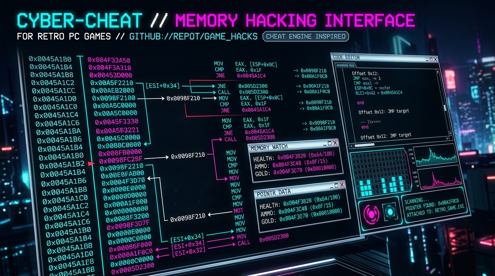
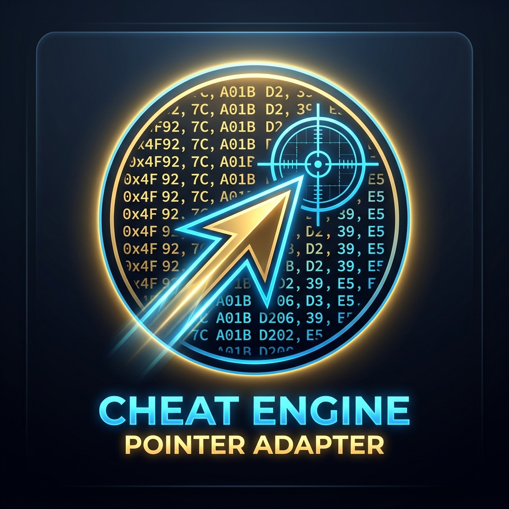

<div align="center">



# 🎯 Cheat Engine Pointer Adapter
### *Universal Multi-OS Bulk Pointer Refactor Utility for Cheat Engine Tables (.CT)*

<p align="center">
  
</p>

[](https://en.wikipedia.org/wiki/C_(programming_language))
[](https://microsoft.com)
[](LICENSE)
[](docs/DEVELOPER_GUIDE.md)
[](lang/)

🌐 **Languages:** **English** • [Bahasa Indonesia](README_id.md)

[**📖 User Guide**](docs/USER_GUIDE.md) • [**🛠️ Developer Guide**](docs/DEVELOPER_GUIDE.md) • [**🤝 Contributing**](docs/CONTRIBUTING.md)

---

</div>

## 📜 Project Background & Problem Statement

**Cheat Engine** is the undisputed world standard for game memory analysis, debugging, and creating cheat tables (`.CT`). Thousands of creators produce extensive, high-quality cheat tables containing hundreds of cheat entries for vintage, emulated, and modern PC titles.

However, there is one **major architectural limitation** in Cheat Engine:
> ⚠️ **Cheat Engine DOES NOT have a feature to Bulk Edit addresses that are formatted as module pointers (e.g. `"pcsx2-qt.exe"+0317C7E8`).**

### The Real-World Dilemma:
When playing games via emulators (such as **PCSX2**, **RPCS3**, **Dolphin**, **Citra**) or PC games with ASLR (*Address Space Layout Randomization*), the emulator's memory base address frequently shifts across different sessions or version upgrades.

If your cheat table contains **over 200 cheat entries** (for instance, a comprehensive Final Fantasy X table with hundreds of pointers for *Character Stats, Inventory, Item Quantities, Equipment Slots, Blitzball, etc.*):
1. **All cheat entries instantly break and become invalid** the moment the memory space shifts.
2. Inside Cheat Engine, you are forced to **manually double-click each entry, recalculate the offset with a hexadecimal calculator, and retype the new address hundreds of times**.
3. This manual process takes **hours**, is mind-numbing, and is highly prone to human typographical errors.

### 💡 The Solution: Cheat Engine Pointer Adapter
**Cheat Engine Pointer Adapter** reduces this entire ordeal to **under a single second**:
1. Perform a quick pointerscan in Cheat Engine for just **one reference cheat** in your active game session (e.g., *1st Item Qty*).
2. Input the original pointer from your table and the new replacement pointer into this tool.
3. The application calculates the exact signed delta and **automatically refactors every matching pointer in your `.CT` file in milliseconds**!

---

## ✨ Key Features

- 🪟 **Extreme Multi-OS Compatibility**: Runs natively on **Windows 95, Windows 98, Windows XP, Windows 7, Windows 8, Windows 10, and Windows 11**.
- 🌐 **Built-in Multi-Language**: Switch seamlessly between **English** and **Bahasa Indonesia** in real time from the GUI without restarting the application.
- 🎨 **Pure Native Win32 GUI**: Featherlight (< 250 KB), zero bloated dependencies, standalone executable with embedded multi-resolution icon.
- 🖱️ **Full Drag & Drop Support**: Drag and drop any `.CT` table file directly into the application window.
- 💡 **Smart Grayed Placeholders**: Input fields display example pointers in gray text that **automatically clear and focus** upon clicking.
- 🛡️ **Intelligent Module Targeting**: Strictly updates pointers belonging to the matching target module (e.g., `"pcsx2-qt.exe"`), while preserving internal game module pointers (e.g., `"FFX.exe"`) intact.
- 🔢 **Signed Hexadecimal Precision**: Preserves original zero-padded hexadecimal formatting (e.g., `%08X`) for positive and negative shifts.
- 💾 **Non-Destructive Output Saving**: Saves modified tables directly in the root directory with safe incremented naming (`_modified.CT`, `(1)`, `(2)`).

---

## 🚀 Quick Start Guide

```
1. Run the executable for your OS (e.g., pointer_adapter_win10.exe or pointer_adapter_win95.exe).
2. Select your .CT table file (click "Browse..." or Drag & Drop the file into the window).
3. Enter the Original Pointer (from your existing table) and Replacement Pointer (from your new scan).
4. Click "Calculate Delta & Refactor Pointers".
5. Done! Your newly refactored table is saved and ready to load in Cheat Engine.
```

*For comprehensive visual instructions and case studies, see [docs/USER_GUIDE.md](docs/USER_GUIDE.md).*

---

## 📦 Pre-Compiled Target Binaries

Each binary executable is compiled with architecture flags and PE subsystem settings tailored specifically to its target OS:

| Executable File | Target Operating System | Architecture | PE Subsystem | Details |
|---|---|---|---|---|
| [`pointer_adapter_win95.exe`](pointer_adapter_win95.exe) | **Windows 95** | 32-bit x86 | `4.0` | Pure ANSI Win32, `i486`, static CRT, zero SSE dependency |
| [`pointer_adapter_win98.exe`](pointer_adapter_win98.exe) | **Windows 98 / ME** | 32-bit x86 | `4.10` | Pure ANSI Win32, `pentium2`, static CRT |
| [`pointer_adapter_winxp.exe`](pointer_adapter_winxp.exe) | **Windows XP** | 32-bit x86 | `5.1` | Win32 Subsystem XP, `pentium4` / SSE2, static CRT |
| [`pointer_adapter_win7.exe`](pointer_adapter_win7.exe) | **Windows 7** | 64-bit x64 | `6.1` | 64-bit Core2 tune, static CRT |
| [`pointer_adapter_win10.exe`](pointer_adapter_win10.exe) | **Windows 10 / 11** | 64-bit x64 | `6.0` | 64-bit Modern x86-64, static CRT |

---

## 🛠️ Building from Source

The repository includes an autonomous **Compiler Engine** (`builder/`) along with a one-click batch script:

```cmd
# Compile all 5 OS targets simultaneously (with windres icon embedding):
build.bat

# Compile a specific target OS via builder.exe:
builder.exe win10
builder.exe win7
builder.exe winxp
builder.exe win98
builder.exe win95

# Display all OS architecture settings and compiler flags:
builder.exe --list
```

*For complete technical documentation regarding the PE subsystem and toolchains, see [docs/DEVELOPER_GUIDE.md](docs/DEVELOPER_GUIDE.md).*

---

## 🤝 Call for Community Participation & Contributing

This project is an open-source initiative created for retro gamers, speedrunners, and reverse engineers worldwide. We warmly welcome your contributions:

1. 🌍 **Translations & Localizations**: Add support for your native language (Japanese, Spanish, Portuguese, German, French, etc.) under [`lang/`](lang/).
2. ⚡ **Feature Development**:
   - Automated Cheat Engine Lua script exporter for runtime re-basing.
   - Multi-level offset refactoring (`<Offsets><Offset>`).
   - Batch folder processing for bulk updating multiple `.CT` files.
3. 🧪 **Vintage Hardware Testing**: Test on real physical Windows 95/98/XP machines or virtual machines and share your feedback.

Read our complete contribution guidelines in [**docs/CONTRIBUTING.md**](docs/CONTRIBUTING.md) or open a **Pull Request (PR)**!

---

## 📄 License

This software is released under the [MIT License](LICENSE). Free for personal, commercial, and community use.
